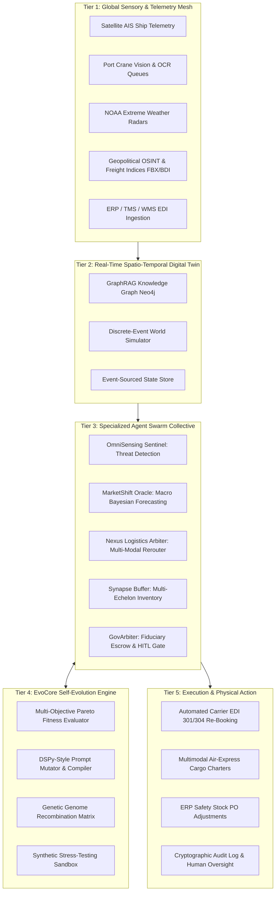

# EvoChain-OS: Architecture & Blueprint for Self-Evolving Autonomous AI Agent Networks in Global Supply Chains

> **Enterprise Strategic & Technical Blueprint**  
> *Autonomous Universal Resilience Architecture for Global Supply Chains & Real-Time Market Shift Prediction*

---

## 1. Executive Summary & The Paradigm Shift

Traditional supply chain management relies on linear enterprise resource planning (ERP), static mathematical programming (Mixed-Integer Linear Programming - MILP), and lagging periodic forecasting (S&OP monthly cycles). In modern global commerce—characterized by sudden maritime chokepoint interdictions (Suez/Red Sea, Panama drought), extreme climate disruption, and volatile commodity swings—these deterministic systems fail due to **high latency**, **inflexibility**, and **the bullwhip effect**.

**EvoChain-OS** represents the transition from static planning to a **Decentralized, Self-Evolving Multi-Agent Collective**. This system couples:
1. **Continuous Real-Time Environmental Ingestion** (AIS satellite ship pings, port crane queues, geopolitical news streams, commodity tickers).
2. **Specialized Autonomous Agent Swarms** operating across sensing, forecasting, combinatorial multimodal routing, inventory buffering, and compliance governance.
3. **A Self-Evolutionary Engine (EvoCore)** that continually optimizes agent prompt instructions, risk aversion coefficients, and decision heuristics using **Reinforcement Learning with AI Feedback (RLAIF)** and **Generational Genetic Recombination** within an internal digital twin simulation sandbox.

---

## 2. System Architecture: The 5-Tier Framework



---

## 3. The 6-Agent Swarm Taxonomy

### 1. OmniSensing Sentinel (`sentinel`)
- **Core Function**: Ingests high-frequency real-time signals from global maritime AIS transponders, port waiting queues, meteorological models, and naval NOTAM alerts.
- **Decision Logic**: Uses statistical anomaly detection ($>2.2\sigma$ deviation from baseline transit velocity) and NLP sentiment analysis over geopolitical news to assign real-time Threat Probability vectors $P(D_i)$ across 14 critical maritime chokepoints and top-50 global container terminals.

### 2. MarketShift Oracle (`oracle`)
- **Core Function**: Bayesian macroeconomic and commodity price forecasting.
- **Decision Logic**: Projects price trajectories across bunker fuels (VLSFO, MGO), container spot freight indices (Drewry, FBX, SCFI), and critical component lead times (e.g., semiconductor foundry lead times). It dampens or anticipates demand amplification before orders hit upstream tiers.

### 3. Nexus Logistics Arbiter (`nexus`)
- **Core Function**: Combinatorial multi-echelon routing and multimodal fleet switching.
- **Decision Logic**: Solves real-time Pareto optimization across three competing dimensions:
  $$\min \left[ \Delta \text{Landed Cost}, \Delta \text{Transit Lead Time}, \Delta \text{Carbon Footprint (MT CO}_2\text{)} \right]$$
- Dynamically allocates modal split: e.g., diverting 20% critical semiconductor wafer stock to emergency air cargo while routing the remaining 80% bulk container volume around the Cape of Good Hope to avoid catastrophic Red Sea delays.

### 4. Synapse Buffer Synthesizer (`synapse`)
- **Core Function**: Multi-echelon dynamic inventory buffer calibration.
- **Decision Logic**: Directly addresses the Bullwhip Effect by using real-time downstream consumption data instead of lagged upstream order variance. When transit delays are forecasted, Synapse dynamically expands safety buffer targets in European or North American Distribution Centers (DCs) and auto-generates advance PO releases with secondary suppliers.

### 5. GovArbiter & Risk Guardian (`gov`)
- **Core Function**: Fiduciary escrow, sanctions screening, and Human-in-the-Loop (HITL) gatekeeper.
- **Decision Logic**: Evaluates every proposed routing or inventory adjustment against corporate ESG caps, OFAC sanctions, and spending limits ($5M automated escrow approval cap). Generates an immutable cryptographic hash for every approved action and triggers an escalation workflow when high-risk thresholds are crossed.

### 6. EvoCore Meta-Optimizer (`evocore`)
- **Core Function**: Self-evolving supervisor of the agent swarm.
- **Decision Logic**: Tracks collective swarm fitness over past operational episodes and simulates hypothetical stress scenarios. Mutates prompt instructions, risk aversion coefficients, and voting weights across generations using **Reinforcement Learning with AI Feedback (RLAIF)** and genetic algorithms.

---

## 4. How the Network Actually Self-Evolves (No Catastrophic Drift)

A common challenge in multi-agent systems is **policy divergence** or hallucinated drift. EvoChain-OS solves this through a four-phase closed-loop evolutionary architecture:

```
[Real Operational History + Synthetic Simulation Episodes]
                     │
                     ▼
          [Multi-Objective Fitness Evaluation]
                     │
                     ▼
      [DSPy Teleprompter Prompt Mutation & Weight Delta]
                     │
                     ▼
       [Digital Twin Sandbox Safety Verification]
                     │
                     ▼
   [Canary Deployment to Production Swarm Nodes]
```

### 1. Multi-Objective Swarm Fitness Function
The evolutionary score $F(g)$ for any generation $g$ is quantified as:
$$F(g) = w_1 \cdot S_{\text{OTIF}} + w_2 \cdot (1 - \text{CostVariance}) + w_3 \cdot S_{\text{Resilience}} + w_4 \cdot (1 - \text{CarbonOverhead})$$
Where:
- $S_{\text{OTIF}}$: On-Time-In-Full delivery success rate.
- $\text{CostVariance}$: Deviation from optimized landed unit budget.
- $S_{\text{Resilience}}$: Time to operational recovery post-disruption (hours vs. industry baseline).
- $\text{CarbonOverhead}$: Penalizes unnecessary high-emission air freight when slower ocean routing meets SLA.

### 2. Generational Prompt Mutation (DSPy-style Compilation)
Instead of hardcoded prompts, agent system prompts are treated as **mutable code parameters**. When EvoCore observes that early warning detection was too slow in Generation 1, it mutates the Sentinel agent's detection prompt from:
*Gen 1 Naive*: `"Alert if port queue exceeds 14 days."`  
to:  
*Gen 4 Adaptive*: `"Trigger predictive early warning if chokepoint AIS density exceeds 2.2σ and naval NOTAM alerts indicate missile/drone hazard. Formulate hybrid modal split immediately."`

### 3. Hyper-Parameter Genome Vector
Each agent carries continuous genome parameters that are cross-bred and mutated:
- $\sigma_{\text{anomaly}}$: Statistical deviation threshold for disruption trigger.
- $\theta_{\text{air\_bridge}}$: Cargo valuation threshold ($/TEU) that justifies air express modal switching.
- $\mu_{\text{safety\_buffer}}$: Dynamic multiplier on regional DC stock buffers.
- $\kappa_{\text{bunker\_hedge}}$: Sensitivity factor for forward fuel price lock-in.

---

## 5. Organizational Implementation Roadmap

| Phase | Duration | Focus | Autonomy Level | Key Milestones |
|---|---|---|---|---|
| **Phase 1: Shadow-Mode Digital Twin** | Months 1–3 | Digital Twin setup & historical replay | **Level 1: Advisory** | Ingest AIS, ERP EDI feeds; agents recommend actions in parallel without execution; benchmark against human logistics team decisions. |
| **Phase 2: Supervised Autonomy & Escrow** | Months 4–6 | Fiduciary gating & closed-loop actions | **Level 2: Supervised HITL** | GovArbiter auto-executes actions below $500k; human logistics managers approve higher-tier reroutes with 1-click cryptographic signing. |
| **Phase 3: Autonomous Self-Evolving Swarm** | Months 7+ | Live multimodal execution & genetic self-tuning | **Level 3: Full Autonomy** | Automated carrier re-booking via EDI 301/304; autonomous air-bridge charters; generational prompt self-tuning enabled. |

---

## 6. How to Run This Project

### Method A: Immediate Web Dashboard (Zero Dependencies)
You can launch the full interactive Digital Twin and Multi-Agent Simulation immediately:
```bash
# In the project root (c:\Users\SOURAV\SahiRate):
npm start
```
Then open your browser to **`http://localhost:3000`**.

### Method B: Python Enterprise Backend
To run the asynchronous Python multi-agent backend:
```bash
cd python_backend
pip install -r requirements.txt
uvicorn server:app --reload --port 8000
```
API Documentation will be live at **`http://localhost:8000/docs`**.
